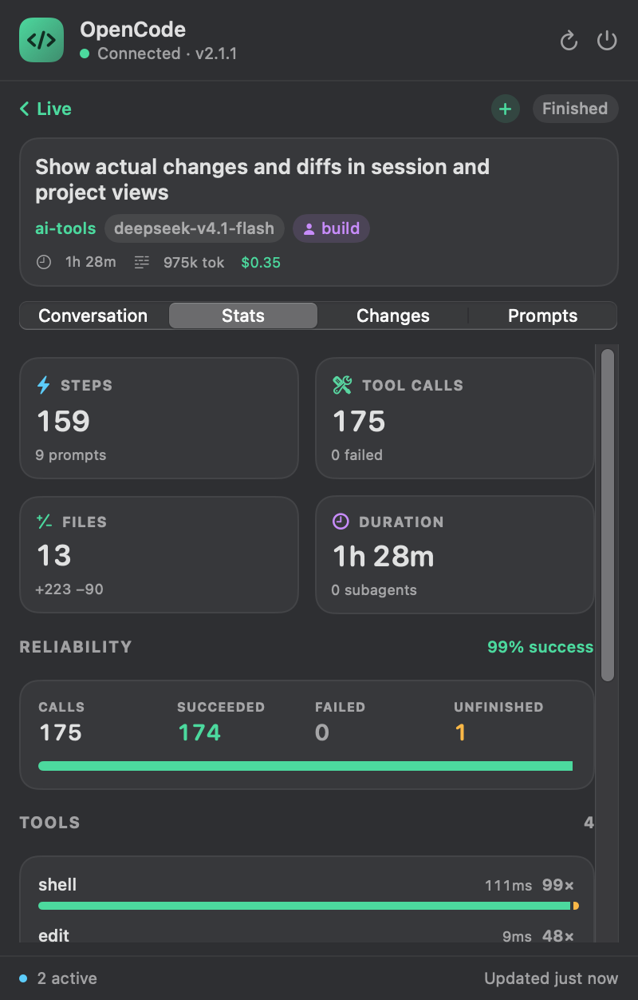
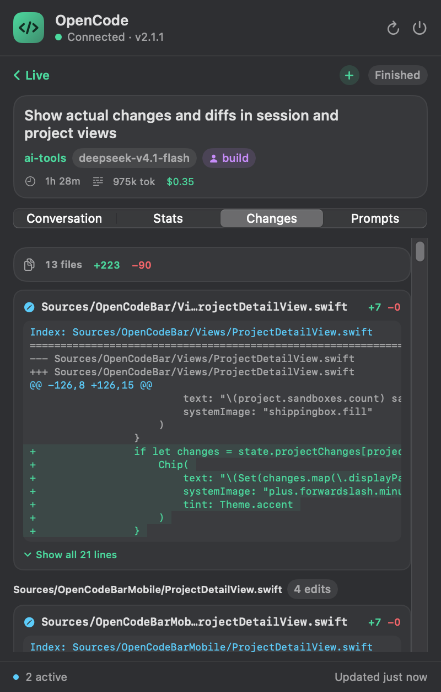
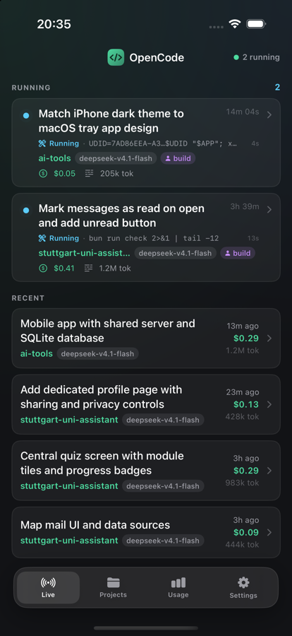
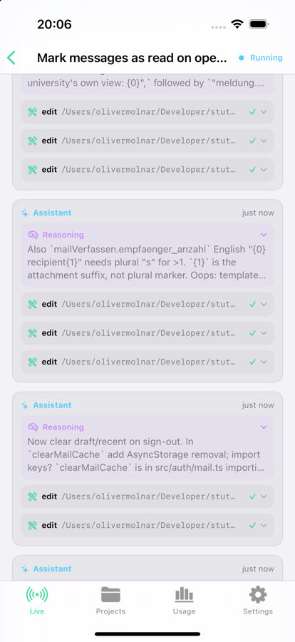
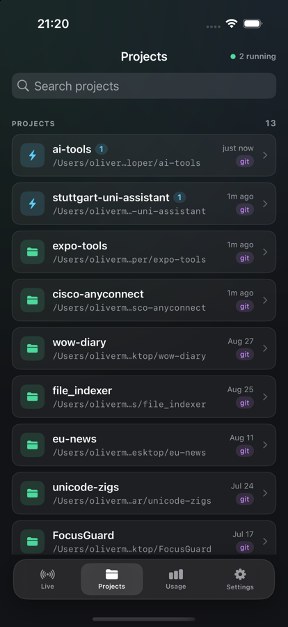
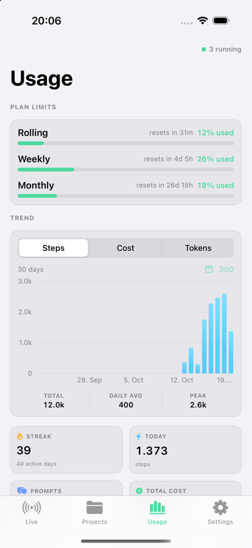

# OpenCodeBar

Watch your [OpenCode](https://opencode.ai) work from a native macOS menu bar app
and from an iPhone/iPad app. Both talk to **OpenCodeBar Hub**, a small Bun +
SQLite server that ingests your local OpenCode service and keeps one shared,
cached history — so the phone can see the Mac's sessions, projects, and usage.

On macOS the menu bar item displays a terminal glyph and, when sessions are
running, the number of active sessions. Clicking it opens a panel with **live**
activity, a full **session** view, per-project **analytics**, and a **usage**
overview. The iOS app has the same four areas, adapted for touch, with the same
dark panel design and a floating tab dock. Its Appearance setting can follow the
system or stay dark/light. Both apps can also start a new session and send a
prompt into an open conversation.

macOS panel:






iOS app:






## Features

**Live**
- Running sessions update in real time via OpenCode's SSE event stream, with new
  rows animating in at the top. Each row shows what the session is doing right
  now — the current tool and its command or path, streaming reasoning, todo
  progress, and the number of running subagents — alongside a pulsing indicator,
  project, model, agent, live cost, elapsed time, and token count.
- Recent sessions with project, model, relative time, cost, and tokens.
- Click any session to open its details: the full conversation with the newest
  message first, a prompts-only list with copy buttons, and expandable reasoning
  and tool calls. The view keeps updating while the session runs and pages back
  through history.
- **Reply from the conversation.** The composer at the bottom of the Chat tab
  sends a prompt into that session. A running session queues the message until
  the current turn finishes, and the conversation refreshes as it arrives.
- **Speak your prompt.** The microphone in the conversation composer and the
  new-session sheet turns speech into text as you talk. It keeps whatever you
  already typed, and the transcript stays editable before you send. Speech
  recognition runs on the device when the current language supports it.
- **Start a new session** from the Live tab or a project page: choose a project
  directory, an optional title, and an optional first message. The new session
  opens immediately, and the first message is sent in the same step.
- **Stats** tab: prompts, steps, tool-call reliability, per-tool failure counts
  and median durations, the recent failures with their errors, file impact, and
  the token mix for that session.
- **Changes** tab: every file the session wrote, with the actual patch, added
  and removed line counts, and a colour-coded diff. Repeated edits to one file
  are grouped, and long patches collapse to a preview. Tool cards in the
  conversation show the same diff instead of raw edit JSON.
- Subagent tree: a session's direct child sessions appear in a **Subagents** tab
  with their own live activity, outcome, cost, and time. Tap one to drill in;
  Back returns to the parent, and each level loads its own children.

**Projects**
- Every project OpenCode has run in, with running work first and the most
  recently active next. Select one to open its detail page: what is running
  right now — with elapsed time, tappable into the session view — plus scoped
  analytics (steps, cost, tokens, streak, model mix) and recent sessions with
  their cost. A **Changes** section aggregates the patches written by the
  project's newest sessions, grouped by session and file. Quick actions open
  the project in Finder or Terminal and copy its path.
- Tool reliability for the project: total calls plus per-tool succeeded, failed,
  and unfinished counts with median durations.
- Scoped trends: an interactive daily chart for steps, cost, or tokens over the
  last 30 / 90 / 365 days or all time, using only that project's data.
- Duplicate records for the same directory are merged, and analytics are
  fetched per project from the stats API rather than derived from the session
  list.

**Usage**
- OpenCode Go plan limits: rolling (5h), weekly, and monthly consumption as
  percentage bars with reset countdowns, read from the Go usage API. Hidden
  when no Go key is configured.
- Usage numbers and plan limits are cached on disk, so the tab keeps showing the
  last known values — flagged as stale — when the service or the API is
  unreachable.
- Summary tiles: streak, active days, today's steps, prompts, sessions, total
  cost, tokens, tool calls, and subagents.
- An interactive daily trend chart for steps, cost, or tokens across the last
  30 / 90 / 365 days or all time.
- Top projects by cost, with the same selectable windows.
- A GitHub-style activity heatmap of daily agent steps.
- Token mix (input / output / reasoning / cache read / cache write).
- Per-model breakdown with steps and cost.
- Tool call success/failure summary.

**Settings**
- Every app connected to the hub — macOS, iOS, and iPadOS — with its device
  name, platform, app version, and whether it is live right now.
- Server information: hub version, address, uptime, cached session/message
  counts, OpenCode state, last sync, and the SQLite path.
- Server controls: sync now, restart the hub, reveal its data/config files, and
  refresh. Pairing shows a scannable QR code plus the copyable link for adding
  another phone.

**iPhone & iPad**
- The same Live, Projects, Usage, and Settings areas as the Mac panel, with the
  same compact panel design, live-activity folding, and a floating tab dock
  built for touch.
- Search projects, pull to refresh any screen, and open a session from a deep
  link. Settings shows hub and OpenCode health, cached session/message counts,
  uptime, and last sync.
- Appearance can follow the system or stay dark or light.
- Pair by scanning the QR code in the Mac app's Settings tab, pasting the hub
  URL and token, or the `opencodebar://pair?url=…&token=…` link the hub prints;
  the token is stored only on the device.

**Shared hub**
- One Bun + SQLite server ingests OpenCode once and serves both apps behind a
  Bearer token. Sessions, messages, file changes, stats, and Go plan limits are
  cached in `~/.local/share/opencodebar/hub.sqlite`, so the iOS app — and the Mac
  app when OpenCode is stopped — still show history and last-known numbers.
- The hub discovers the local service, polls read endpoints, forwards the SSE
  stream, and forwards prompts and new-session requests back to OpenCode.

Both apps can start sessions and send prompts; neither stops or deletes
sessions.

## How it works

OpenCode runs a client-server architecture. Interfaces such as the TUI talk to a
background service that listens on loopback and is protected by HTTP Basic auth.

OpenCodeBar Hub sits between that service and the apps:

```
OpenCode service (loopback, Basic auth)
          │  REST + SSE
          ▼
OpenCodeBar Hub (Bun + SQLite, Bearer auth)
          │  cached REST + SSE, mirrored shapes
    ┌─────┴─────┐
    ▼           ▼
 macOS app   iOS app
```

The hub:

1. Discovers the local OpenCode service the same way the old app did — the
   password from `~/.config/opencode/service.json`
   (or `$XDG_CONFIG_HOME/opencode/service.json`), the URL from
   `opencode service status`, then `lsof`, then the server log.
2. Polls read endpoints on a 5s / 60s cadence, subscribes to `/api/event`,
   and writes sessions, projects, messages, stats, and Go plan usage into
   `~/.local/share/opencodebar/hub.sqlite`. The cache keeps serving when OpenCode
   stops or restarts on a new port. Writes from the apps — creating a session
   and prompting one — are forwarded to the same service.
3. Serves a stable API that mirrors OpenCode's shapes — `/api/session`,
   `/api/session/{id}`, `/api/session/{id}/message`, `/api/session/{id}/changes`,
   `/api/session/{id}/stats`, `/api/project`, `/api/project/{id}/changes`,
   `/api/experimental/session/stats` — plus `/api/session/{id}/prompt`
   (`POST`), `/api/session` (`POST`), `/api/usage`, `/api/health`, `/api/devices`,
   `/api/sync`, `/api/server/restart` (`POST`), and `/api/event`. Clients
   authenticate with a Bearer token and identify their platform with
   `X-OpenCodeBar-*` headers so the settings screen can list connected devices.
4. Forwards OpenCode events to every connected client, so both apps update live.
   The stream also carries `hub.*` notices (`hub.connected`, `hub.sessions`,
   `hub.stats`, `hub.usage`) that tell clients when cached data changed.

Endpoints the hub reads from OpenCode: `/api/info`, `/api/session`,
`/api/session/active`, `/api/session/{id}`, `/api/session/{id}/message`,
`/api/project`, `/api/experimental/session/stats`, and `/api/event`. It writes
through `POST /api/session` and `POST /api/session/{id}/prompt`.

The event stream does more than trigger refreshes. `session.step.*`,
`session.reasoning.*`, `session.text.*`, `session.tool.*`, `session.usage.*`,
and `permission.*` events are folded into a per-session activity snapshot, which
is what the Live rows show. Cost and token counts move as `session.usage.updated`
arrives instead of waiting for the next poll. When the stream is missed — on
launch or after a reconnect — the newest messages are read back to rebuild the
snapshot, including the latest `todowrite` list. Both apps fold events the same
way from the shared payloads.

The trend charts use the stats API's daily activity for steps, and group the
full session list (`/api/session?limit=1000`, fetched on the slow cycle) by day
for cost and tokens. Project pages use the same series scoped to that project.
Message history is cached the first time a session is opened, so paging back
through it works offline. The Changes views read the `metadata.files` patches
that OpenCode attaches to edit/write tool calls; the hub extracts them while
caching messages, so patches survive an OpenCode restart. Opening a session's
Changes tab hydrates its full history the first time; project changes hydrate
the newest 10 sessions (adjustable with `?sessions=`) and always include any
older changes already cached.

Tool reliability comes from two places. Project and usage breakdowns ask the
stats API for `tools=detail`, which adds per-tool succeeded/failed/unfinished
counts and median durations. Sessions have no stats endpoint upstream, so the
hub derives their numbers from cached messages: tool parts are indexed by name
and outcome when a message is cached, and the first `/api/session/{id}/stats`
request pages through up to 30 pages of history. The response says whether the
history is complete, and the Stats tab notes when totals cover only the loaded
window.

### Connecting the apps

The hub writes its URL and token to `~/.config/opencode/opencodebar-hub.json`
(owner-only) when it starts, so the Mac app connects with no configuration. The
iOS app pairs by scanning the QR code in the Mac app's Settings tab, or by
pasting that URL and token, or the `opencodebar://pair?url=…&token=…` link the
hub prints. The QR code uses the Mac's LAN address so the phone can reach the
hub. Overrides:

1. `$OPENCODEBAR_HUB_URL` / `$OPENCODEBAR_HUB_TOKEN`
2. `hubURL` / `hubToken` in `~/.config/opencode/opencodebar.json`
3. the generated `opencodebar-hub.json`

For Go plan limits the hub calls the console's usage endpoint,
`https://opencode.ai/zen/go/v1/usage`, and caches the result for both apps. The
key is resolved in this order:

1. `$OPENCODE_GO_USAGE_KEY`
2. `$OPENCODE_API_KEY`
3. `goUsageKey` in `~/.config/opencode/opencodebar.json`
4. the `opencode-go` (then `opencode`) key in `~/.local/share/opencode/auth.json`

Step 3 exists so a read-only or service-account key can be used for usage
without replacing the credential OpenCode uses for inference.

## Requirements

- macOS 14 (Sonoma) or later for the menu bar app.
- iOS 17 or later for the mobile app (simulator or device).
- [Bun](https://bun.sh) 1.1+ for the hub, and Xcode or the Swift toolchain
  (`swift` on your `PATH`) for the Mac app.
- Xcode with the iOS simulator, plus [XcodeGen](https://github.com/yonaskolb/XcodeGen)
  (`brew install xcodegen`), to build the iOS app.
- To run the iOS app on a physical device, an Apple ID signed into Xcode with a
  development team, and Developer Mode enabled on the device.
- OpenCode V2 running as the background service (`opencode service status`
  prints a URL).

## Build and run

```sh
# 1. Start the hub. The first run generates a token and prints the URL,
#    LAN address, and a pairing link for the phone.
make hub

# 2. Build and launch the macOS menu bar app.
make run

# 3. Build, install, and launch the iOS app in a simulator, paired with the hub.
make mobile-run

# ... or on a connected iPhone/iPad (signing required).
make mobile-device
```

```sh
make run        # build dist/OpenCodeBar.app and launch it
make restart    # rebuild and restart the running app
```

`make restart` runs `Scripts/restart.sh`, which builds first and only then
stops the old instance — so a failed build leaves the current app running.
The script can also be called directly:

```sh
Scripts/restart.sh --no-build      # relaunch the existing bundle
CONFIG=debug Scripts/restart.sh    # rebuild a debug bundle instead
```

Other targets:

```sh
make build         # swift build (debug)
make test          # swift test
make app           # assemble dist/OpenCodeBar.app (release)
make preview       # open the panel in a normal window for design work
make shots         # regenerate docs/screenshots
make icon          # regenerate the app icon
make hub           # run the SQLite sync hub (foreground)
make hub-dev       # hub with auto-reload
make hub-test      # hub unit tests (Bun)
make mobile-build  # build the iOS app for the simulator
make mobile-run    # build, install, launch, and pair the iOS app in a simulator
make mobile-device # the same on a connected iPhone/iPad
make clean         # remove build artifacts and dist/
```

`make mobile-device` builds with the team currently selected in Xcode, falling
back to the team on your Apple Development certificate; set `DEVELOPMENT_TEAM=…`
to choose another team. If more than one phone is connected, pick one with
`DEVICE="iPhone von Oli"` (name, UDID, or serial number). The script reuses the
hub's token but pairs over the Mac's LAN address, since `127.0.0.1` on the phone
points at the phone itself. It all happens in one step:

```sh
make mobile-device DEVICE="iPhone von Oli"

Scripts/run-mobile-device.sh --no-build   # reinstall the last build
Scripts/run-mobile-device.sh --console    # stream the app's log output
```

On the first run, connect and unlock the device, tap **Trust**, and enable
**Settings → Privacy & Security → Developer Mode**.

The first Mac build generates `Assets/AppIcon.icns` and ad-hoc signs the bundle.

To launch the Mac app at login, add `dist/OpenCodeBar.app` in **System Settings →
General → Login Items**. The hub can run as a launch agent if you want the phone
to reach it without starting a terminal.

## Website

A static landing page lives in [`docs/`](docs/index.html) and uses the same
screenshots referenced above. It is plain HTML/CSS with a small progressive-
enhancement script — no build step.

```sh
open docs/index.html
```

To publish it with GitHub Pages: **Settings → Pages → Source: Deploy from a
branch → `main` / `/docs`**. It is then served at
`https://403access.github.io/ai-tools/`.

## Project layout

```
Sources/OpenCodeBar/          macOS menu bar app (SwiftPM)
  OpenCodeBarApp.swift      MenuBarExtra scene
  main.swift                entry point (also handles --preview)
  AppState.swift            observable state, polling, derived data
  Core/
    HubAPI.swift            async client for the hub (shared with iOS)
    HubEventStream.swift    SSE subscription with reconnect (shared)
    HubDiscovery.swift      reads the hub URL + token (macOS)
    ServiceDiscovery.swift  OpenCode config paths
    DeviceIdentity.swift    stable client id + platform headers (shared)
    UsageCache.swift        last-known usage on disk
  Support/
    QRCode.swift            pairing QR rendering
  Models/Models.swift       Codable models for the API (shared)
  Models/OpenCodeEvent.swift  decoded event payloads (shared)
  Models/SessionActivity.swift  live "what is it doing" state (shared)
  Models/SubagentOrdering.swift  running-first ordering for child sessions
  Models/SessionOrdering.swift  most-recent-first ordering for feeds
  Models/GoUsage.swift      Go plan windows (shared)
  Views/                    SwiftUI panel, tabs, heatmap, components
    ChangeViews.swift       patch cards and change summaries
    NewSessionSheet.swift   start a session with an optional first prompt
    SessionStatsView.swift  per-session reliability and failures
    SettingsTab.swift       connected devices and server controls
    SubagentViews.swift     tap-through child-session tree
  Preview/PreviewRunner.swift

Sources/OpenCodeBarMobile/    iOS app (XcodeGen target)
  OpenCodeBarMobileApp.swift  app entry + tab bar
  MobileStore.swift           observable state for the hub
  HubSettings.swift           URL + token storage and pairing links
  PairingScanner.swift        camera QR scanner for pairing
  LiveView.swift              running/recent sessions
  SessionDetailView.swift     conversation, stats, changes, prompts, subagents
  NewSessionSheet.swift       start a session from the phone
  MobileMessageViews.swift    message cards
  MobileChangeViews.swift     patch cards and change summaries
  MobileSessionStatsView.swift  per-session reliability and failures
  ProjectsView.swift          project list + search
  ProjectDetailView.swift     scoped analytics and project changes
  UsageView.swift             plan limits, trends, stats
  MobileCharts.swift          Swift Charts trend cards
  SettingsView.swift          appearance, pairing, and status
  MobileComponents.swift      shared mobile views
  MobileTheme.swift           dark design tokens and shared backgrounds

server/                       Bun + TypeScript + SQLite hub
  src/index.ts                entry point and startup output
  src/config.ts               env/config resolution, pairing link
  src/opencode.ts             OpenCode discovery, REST, SSE, Go usage
  src/db.ts                   SQLite schema and queries
  src/hub.ts                  polling, event fan-out, cached reads
  src/api.ts                  HTTP routes and SSE clients
  test/                       Bun tests for the database and API

project.yml                   XcodeGen spec for the iOS app
Mobile/Info.plist             generated by XcodeGen
Scripts/
  build-app.sh                assemble the macOS .app bundle
  restart.sh                  rebuild and restart the Mac app
  run-mobile.sh               install, launch, and pair the iOS app in a simulator
  run-mobile-device.sh        the same on a physical iPhone/iPad
  make-icon.swift             generate the app icon
Tests/OpenCodeBarTests/       Swift tests (event folding, ordering)
```

## Development notes

- `--preview` runs the panel in a regular window instead of the menu bar
  popover, which makes screenshots and layout iteration easy.
  `--preview --tab usage` opens the Usage tab directly.
- `--screenshot <path>` renders the panel offscreen to a PNG and exits.
  `--screenshot out.png --scale 2 --tab usage` produces a 2x image for the
  website and README. Add `--detail` (optionally `--detail-mode prompts`,
  `stats`, or `changes`) to render the session detail view, or
  `--project-detail` for the first project's detail page. `--session <id>` opens
  a specific session; combine it with `--detail-mode subagents` to inspect a
  session's child sessions. Stats and Changes hydrate history on the first
  request, so open those tabs once (or warm the hub cache) if a shot would
  otherwise capture the loading state.
- `OPENCODEBAR_DEBUG_SUBAGENTS=1` logs hub/subagent requests to stdout.
- The menu bar glyph uses SF Symbols (`terminal` / `terminal.fill`).
- iOS screenshot tooling (Debug builds): `OPENCODEBAR_TAB=live|projects|usage|settings`
  selects the starting tab, and `OPENCODEBAR_OPEN_SESSION=running` (or a session
  id) opens a session on launch. With `simctl`:
  `SIMCTL_CHILD_OPENCODEBAR_TAB=usage xcrun simctl launch booted dev.opencodebar.mobile`.
- Hub environment: `OPENCODEBAR_HUB_PORT` (default 8787),
  `OPENCODEBAR_HUB_HOST`, `OPENCODEBAR_HUB_DB`, `OPENCODEBAR_HUB_TOKEN`,
  `OPENCODEBAR_HUB_URL` (clients), `OPENCODEBAR_LOG_LEVEL`.
- `OPENCODE_GO_USAGE_URL` points the hub's Go limits client at a different URL,
  which is how the Plan limits UI is exercised without a live Go key.
- `OPENCODE_API_KEY` overrides the Go API key read from `auth.json`, and
  `OPENCODE_GO_USAGE_KEY` overrides both. GUI-launched builds may not inherit
  a shell environment, so `~/.config/opencode/opencodebar.json` is usually the
  more reliable place to keep a usage-only key.

## Limitations

- The Mac app needs macOS 14+; the mobile app needs iOS 17+. The hub is a Bun
  process that must be reachable over the network for the phone.
- The apps can start sessions and send prompts, but not interrupt, stop, or
  delete them. Prompts sent to a running session are queued behind the current
  turn.
- The hub relies on the local OpenCode service; when the service is stopped it
  keeps serving cached data and shows an offline state, reconnecting when
  OpenCode returns.
- Go plan limits come from an undocumented console endpoint. Credits, the
  auto-recharge setting, and extra usage are console-only and are not shown.
- The hub binds `0.0.0.0` by default so the phone can reach it; a Bearer token
  is always required. Use a trusted network, or set `OPENCODEBAR_HUB_HOST=127.0.0.1`
  and a tunnel if you need remote access.
- The iOS app allows arbitrary HTTP loads because the hub is usually a plain
  HTTP address on the LAN; there is no App Store signing setup in the repo yet.
- Mac usage numbers are cached at `~/Library/Caches/OpenCodeBar/usage.json` (safe
  to delete), and the hub caches everything in
  `~/.local/share/opencodebar/hub.sqlite` (also safe to delete). A stale cache is
  always preferred over an empty tab.

See [NOTES.md](NOTES.md) for follow-ups and known polish items.
