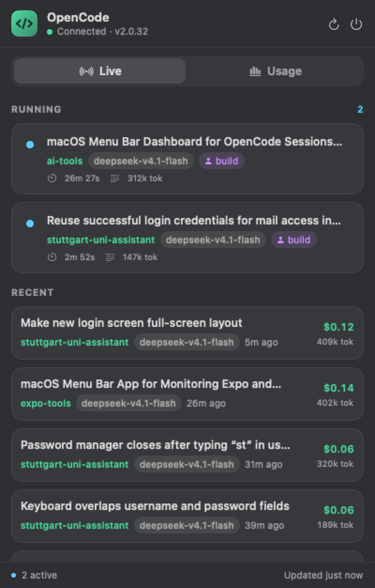
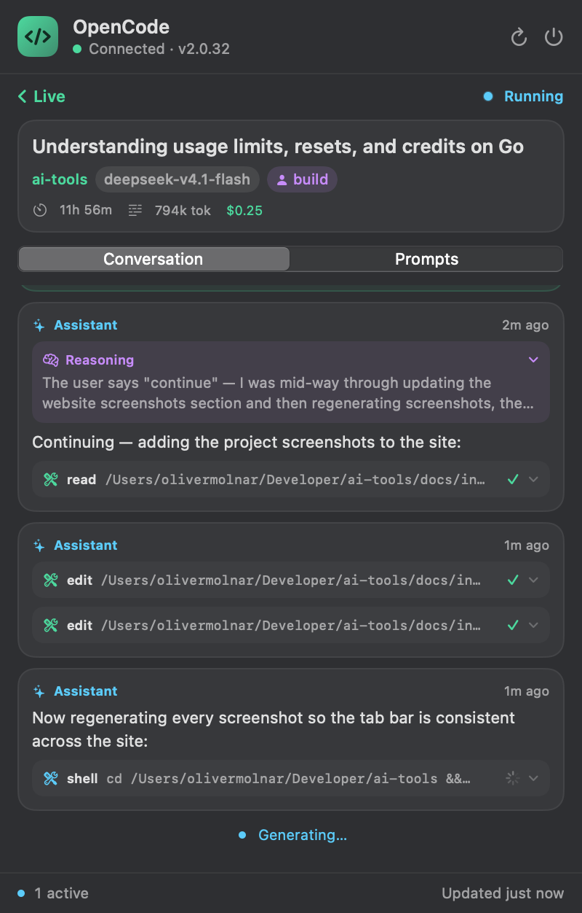
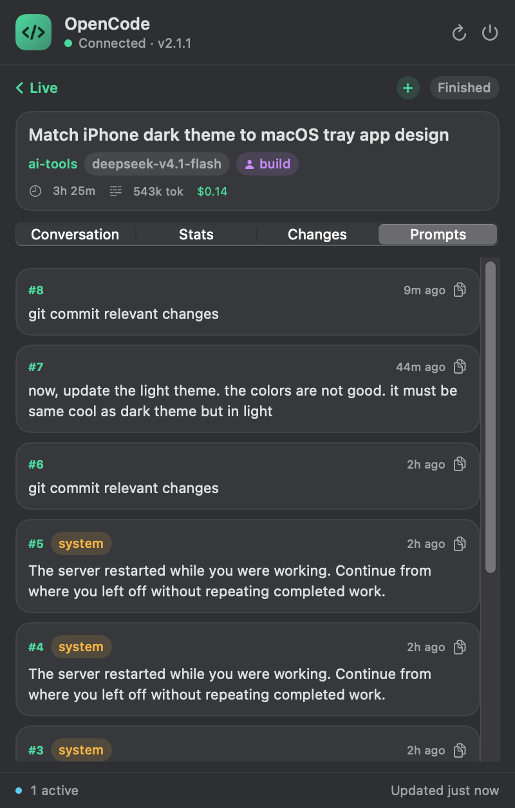
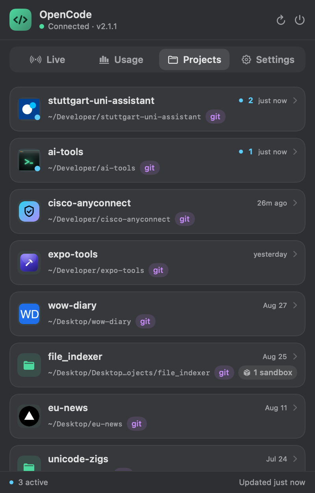
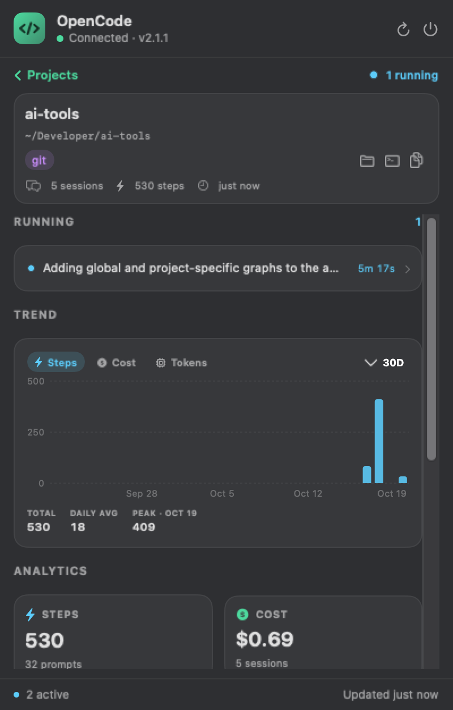
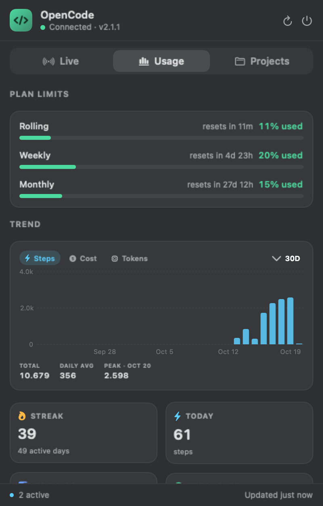

# OpenCodeBar

A native macOS menu bar app that shows what your [OpenCode](https://opencode.ai)
background service is doing — at a glance, without leaving your current window.

The menu bar item displays a terminal glyph and, when sessions are running, the
number of active sessions. Clicking it opens a panel with **live** activity, a
full **session** view, per-project **analytics**, and a **usage** overview.








## Features

**Live**
- Running sessions update in real time via OpenCode's SSE event stream, each with
  a pulsing indicator, project, model, agent, elapsed time, and token count.
- Recent sessions with project, model, relative time, cost, and tokens.
- Click any session to open its details: the full conversation, a prompts-only
  list with copy buttons, and expandable reasoning and tool calls. The view
  keeps updating while the session runs and pages back through history.

**Projects**
- Every project OpenCode has run in, with running work first and the most
  recently active next. Select one to open its detail page: what is running
  right now — with elapsed time, tappable into the session view — plus scoped
  analytics (steps, cost, tokens, streak, model mix) and recent sessions with
  their cost. Quick actions open the project in Finder or Terminal and copy its
  path.
- Scoped trends: an interactive daily chart for steps, cost, or tokens over the
  last 30 / 90 / 365 days or all time, using only that project's data.
- Duplicate records for the same directory are merged, and analytics are
  fetched per project from the stats API rather than derived from the session
  list.

**Usage**
- OpenCode Go plan limits: rolling (5h), weekly, and monthly consumption as
  percentage bars with reset countdowns, read from the Go usage API. Hidden
  when no Go key is configured.
- Usage numbers and plan limits are cached on disk, so the tab keeps showing the
  last known values — flagged as stale — when the service or the API is
  unreachable.
- Summary tiles: streak, active days, today's steps, prompts, sessions, total
  cost, tokens, tool calls, and subagents.
- An interactive daily trend chart for steps, cost, or tokens across the last
  30 / 90 / 365 days or all time.
- Top projects by cost, with the same selectable windows.
- A GitHub-style activity heatmap of daily agent steps.
- Token mix (input / output / reasoning / cache read / cache write).
- Per-model breakdown with steps and cost.
- Tool call success/failure summary.

The app is **monitor-only**: it never starts, stops, or modifies sessions.

## How it works

OpenCode runs a client-server architecture. Interfaces such as the TUI talk to a
background service that listens on loopback and is protected by HTTP Basic auth.

OpenCodeBar:

1. Reads the service password from `~/.config/opencode/service.json`
   (or `$XDG_CONFIG_HOME/opencode/service.json`).
2. Discovers the service URL with `opencode service status`, falling back to
   `lsof` and the server log.
3. Polls a few read-only endpoints and subscribes to `/api/event` for instant
   updates. If the service restarts on a new port, the app rediscovers it
   automatically.

Endpoints used: `/api/info`, `/api/session`, `/api/session/active`,
`/api/session/{id}`, `/api/session/{id}/message`, `/api/project`,
`/api/experimental/session/stats`, and
`/api/event`.

The trend charts use the stats API's daily activity for steps, and group the
full session list (`/api/session?limit=1000`, fetched on the slow cycle) by day
for cost and tokens. Project pages use the same series scoped to that project.

The Projects tab reuses those with a scope: `/api/experimental/session/stats?project={id}`
and `/api/session?project={id}`, fetched only when you open a project.

For Go plan limits the app additionally calls the console's usage endpoint,
`https://opencode.ai/zen/go/v1/usage`. That data is not part of the local
service API, and the key is resolved in this order:

1. `$OPENCODE_GO_USAGE_KEY`
2. `$OPENCODE_API_KEY`
3. `goUsageKey` in `~/.config/opencode/opencodebar.json`
4. the `opencode-go` (then `opencode`) key in `~/.local/share/opencode/auth.json`

Step 3 exists so a read-only or service-account key can be used for usage
without replacing the credential OpenCode uses for inference.

## Requirements

- macOS 14 (Sonoma) or later.
- Xcode or the Swift toolchain (`swift` on your `PATH`).
- OpenCode V2 running as the background service (`opencode service status`
  prints a URL).

## Build and run

```sh
make run        # build dist/OpenCodeBar.app and launch it
make restart    # rebuild and restart the running app
```

`make restart` runs `Scripts/restart.sh`, which builds first and only then
stops the old instance — so a failed build leaves the current app running.
The script can also be called directly:

```sh
Scripts/restart.sh --no-build      # relaunch the existing bundle
CONFIG=debug Scripts/restart.sh    # rebuild a debug bundle instead
```

Other targets:

```sh
make build      # swift build (debug)
make app        # assemble dist/OpenCodeBar.app (release)
make preview    # open the panel in a normal window for design work
make shots      # regenerate docs/screenshots
make icon       # regenerate the app icon
make clean      # remove build artifacts and dist/
```

The first build generates `Assets/AppIcon.icns` and ad-hoc signs the bundle.

To launch at login, add `dist/OpenCodeBar.app` in **System Settings → General →
Login Items**.

## Website

A static landing page lives in [`docs/`](docs/index.html) and uses the same
screenshots referenced above. It is plain HTML/CSS with a small progressive-
enhancement script — no build step.

```sh
open docs/index.html
```

To publish it with GitHub Pages: **Settings → Pages → Source: Deploy from a
branch → `main` / `/docs`**. It is then served at
`https://403access.github.io/ai-tools/`.

## Project layout

```
Sources/OpenCodeBar/
  OpenCodeBarApp.swift      MenuBarExtra scene
  main.swift                entry point (also handles --preview)
  AppState.swift            observable state, polling, derived data
  Core/
    ServiceDiscovery.swift  password + URL discovery
    OpenCodeAPI.swift       async HTTP client
    GoUsageClient.swift     Go plan usage (console endpoint)
    EventStream.swift       SSE subscription with reconnect
  Models/Models.swift       Codable models for the API
  Views/                    SwiftUI panel, tabs, heatmap, components
  Preview/PreviewRunner.swift
Scripts/
  build-app.sh              assemble the .app bundle
  restart.sh                rebuild and restart the app
  make-icon.swift           generate the app icon
```

## Development notes

- `--preview` runs the panel in a regular window instead of the menu bar
  popover, which makes screenshots and layout iteration easy.
  `--preview --tab usage` opens the Usage tab directly.
- `--screenshot <path>` renders the panel offscreen to a PNG and exits.
  `--screenshot out.png --scale 2 --tab usage` produces a 2x image for the
  website and README. Add `--detail` (optionally `--detail-mode prompts`) to
  render the session detail view, or `--project-detail` for the first project's
  detail page.
- The menu bar glyph uses SF Symbols (`terminal` / `terminal.fill`).
- `OPENCODE_GO_USAGE_URL` points the Go limits client at a different URL, which
  is how the Plan limits UI is exercised without a live Go key.
- `OPENCODE_API_KEY` overrides the Go API key read from `auth.json`, and
  `OPENCODE_GO_USAGE_KEY` overrides both. GUI-launched builds may not inherit
  a shell environment, so `~/.config/opencode/opencodebar.json` is usually the
  more reliable place to keep a usage-only key.

## Limitations

- macOS only.
- Monitor-only by design; it does not control sessions.
- Relies on the local OpenCode service; when the service is stopped the panel
  shows an offline state and reconnects automatically.
- Go plan limits come from an undocumented console endpoint. Credits, the
  auto-recharge setting, and extra usage are console-only and are not shown.
- Usage numbers are cached at `~/Library/Caches/OpenCodeBar/usage.json` (safe to
  delete). A stale cache is always preferred over an empty tab, so a very old
  file can be shown alongside its age.

See [NOTES.md](NOTES.md) for follow-ups and known polish items.
